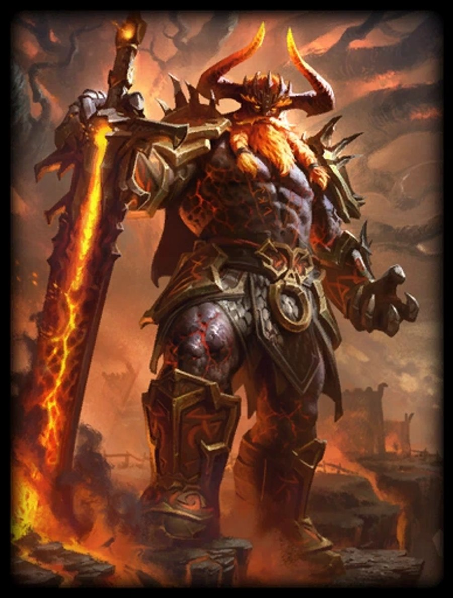

# BO3 Surtr Mod

> Surtr just got into the battlegrounds of Black Ops 3 Zombies!

Surtr is a mod for Call of Duty: Black Ops 3 focused on playing BO3 **safely**. It's compatible with all game versions and has full cooperative support: almost everything works for **all players**, not only the host, plus it has full speedrunning support.

## How to use

Surtr is **injected** into Black Ops 3, so you don't need any modding knowledge. Everything you need comes in **one zip file**: a compiled Surtr file (`.gscc`) and two `.bat` files that do all the work for you — they even download the special compiler that injects the mod into the game.

The quickest way to get it: download **[Download-Surtr.bat](https://github.com/Luisete2105/Bo3-Surtr/raw/main/Download-Surtr.bat)** and **double-click it** — it downloads and extracts the latest Surtr release for you. No browsing, no unzipping.

### 1. Download and extract

**Easy way — let Download-Surtr.bat do it:**

1. Download [Download-Surtr.bat](https://github.com/Luisete2105/Bo3-Surtr/raw/main/Download-Surtr.bat).
2. Save it anywhere, then **double-click it**.
3. It looks for the latest Surtr release, downloads it and extracts it right next to the `.bat` file. When it prints **"Done!"** the latest version is ready to use.

> **Note:** Windows may show a SmartScreen warning or an antivirus pop-up the first time. The script is safe — click **More info** → **Run anyway** if that happens.

**Manual way — grab the zip by hand:**

1. Go to the [Releases](https://github.com/Luisete2105/bo3-surtr/releases) page of this repository.
2. Download the latest release (for example `Surtr_v0.1.0.zip`).
3. Extract the `.zip`: right-click it, choose **"Extract All..."** and click **Extract**. Any folder is fine (the Desktop works).

You should now see these files:

| File | What it does |
| --- | --- |
| **`Launch Game + Load Mod.bat`** | **Use this one.** Launches Black Ops 3 through Steam and then loads Surtr automatically. |
| **`Load Mod.bat`** | Loads Surtr if the game is already open. |
| `Inject.ps1` | The injector used by the `.bat` files. Don't rename or delete it. |
| `surtr_0.1.0_getkey.gscc` | The compiled Surtr mod itself. |
| `Surtr versions` | Custom Surtr versions made by other players (optional). |
| `Livesplit` | Surtr's LiveSplit autosplitter (optional). |
| `Bo3 Offline Files` | Unlocks mega gums and the super EE reward on offline mode (optional). See [Offline unlocks](Docs/Offline_Unlocks.md). |

> **What does `_getkey` mean?**
> Precompiled Surtr versions ending in `_getkey` (like `surtr_0.1.0_getkey.gscc`) are built with a custom compiler function. Thanks to it, the **host** of the game can use the keyboard functionality without needing a Surtr cfg.

> **Important:** Keep these files together in the same folder. The `.bat` files load everything from their own folder.

### 2. Launch the game and load the mod

If Windows asks for permission at any point, click **Yes/Allow**. The first time you run it, Surtr tells Windows Defender to ignore its own folder — the injector can look like a false positive to antivirus software.

1. Double-click **`Launch Game + Load Mod.bat`**.
2. A black window opens. **Let it work** — it checks Windows Defender, then launches Black Ops 3 through Steam for you.
3. When the window detects the game it injects Surtr automatically.
4. Wait until it prints **`Injection finished.`**, then press any key to close the window.

If the game is **already open**, double-click **`Load Mod.bat`** instead and wait for the same message.

### 3. Check that it worked

Load into a match and you'll see a **"Surtr v0.1.0"** banner flash on your screen. All Surtr commands are then available in the in-game console (`~`) — see [Commands](Docs/Commands.md) for the full list.

### 4. Use a custom Surtr version (optional)

The `Surtr versions` folder contains custom versions of Surtr made by other players. To use one, copy the `.gscc` you want from `Surtr versions` into the main folder and **delete the other `surtr*.gscc` file**, so only one compiled Surtr file remains (the injector loads the one `surtr` file it finds).

### 5. LiveSplit (optional)

Surtr comes with a LiveSplit autosplitter to time your runs. Open the `Livesplit` folder and pick one of the included layouts (`.lss`), or add `bo3-surtr-release.asl` as a **Scriptable Component** on your splits. See [Splits](Docs/Splits.md) for the in-game auto-split commands.

> **Note:** the mod is injected into the current game session, so Surtr loads automatically every time you run `Launch Game + Load Mod.bat`.

## Play on a safe BO3 version (recommended)

Most BO3 speedrun mods force you to **downgrade** your game to an old, vulnerable build, and they don't support the T7 Patch. Surtr runs on the **current BO3 version** and supports the T7 Patch, but you still need to actually be on a safe version.

Follow the instructions on **Bo3-Load-Version** to switch your game to a safe build with T7 Patch support:

- [Bo3-Load-Version](https://github.com/Luisete2105/Bo3-Load-Version)

Surtr checks this every time you play: if your BO3 version is outdated or the T7 Patch is not active, it shows you a warning in-game.

## Documentation

This project uses a comprehensive documentation system that links to multiple markdown files for easy navigation:

 - [Commands](Docs/Commands.md) - Complete list of console commands.
 - [HUD Elements](Docs/Huds.md) - Shared, zombie and multiplayer HUD elements.
 - [Splits](Docs/Splits.md) - LiveSplit auto-splits, grouped per map.
 - [EE Step autocompleter](Docs/EE_Autocomplete.md) - Supported EEs with autocompleter.
 - [Practice States](Docs/States.md) - Supported practice states, grouped per map.
 - [Zombie World Records rules](Docs/zwr_rules.md) - Rules enforced by Zombie World Records and how Surtr handles them.
 - [Offline unlocks](Docs/Offline_Unlocks.md) - Get mega gums and the super EE reward on offline mode.
 - [To do list](Docs/todo.md) - Planned things that I may add.

## How can I help?
    
    If you wish to contribute to Surtr, you can search the code for "todo" to find things that I haven't polished or just skipped (I am lazy).
    Otherwise, you can read the [To do list](Docs/todo.md) to see what things I am planning to add. Alternatively, you can also add your own suggestions.

## Name corrections and suggestions

    I want to make Surtr as intuitive as possible, if there is any name that you think would suit an existing command better, please let me know.
    Same with grammar corrections.
    If you get an unexpected error message, please let me know (An error saying that a command is cheat protected is not an unexpected message, use common sense).

## I want something that is not on the mod

If there is something you would like to be added to Surtr you have some options:

- I want to contribute!
    You can make a pull request with the changes and as long as it's tested and doesn't give Dev 2 errors, it should be accepted.

- I don't know how to code
    Don't worry, you can watch the [Tutorials]( https://www.youtube.com/watch?v=zGKpVVFqx5I ) I made and start learning!

- I don't want to learn
    The last option is to request it directly from me. To avoid nonsense, I am charging a minimum price of €5, it could be more depending on the request and it must be paid via PayPal.

## Features

This mod includes:
- LiveSplit autosplitter AND manual splitter for all players! (you can manually unsplit as well).
- You can use Gobblegums without deducting your tokens and even use them if you don't have any!
- All commands work for all players!
- If you make your own Surtr cfg, you can have custom binds while not being the host of the game!
- Quick chat messages, right now it's a Proof Of Concept and currently uses [Smite Chat Commands]( https://smite.fandom.com/wiki/Voice_Guided_System ).

## FAQ

- Q: Practice mode is disabled, why doesn't the watermark disappear?
- A: Because you changed a Dvar and you didn't set it to its original value. The command "Restore_Dvars" does it for you automatically.

## License

This project is licensed under the GNU General Public License v3 - see the [License](LICENSE) file for details.